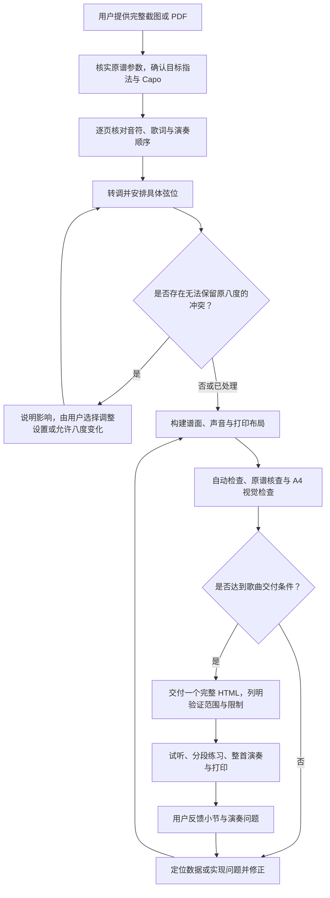

# SmartChord · 智能吉他谱 产品需求文档 v0.1.0

**产品版本：** v0.1.0  
**文档状态：** 待用户审阅  
**版本定位：** 首个产品版本，建立从完整原谱到离线交互乐谱的制谱与练习闭环。  
**更新日期：** 2026-10-14，Asia/Singapore

本文定义 SmartChord v0.1.0 的产品定位、用户需求、功能方案、完整流程和验收标准。当前《仓颉》作为完整实例，实际实现情况与尚未完成的验收见第 14 节。

## 目录

1. [项目概述](#1-项目概述)
2. [项目背景](#2-项目背景)
3. [目标用户与核心场景](#3-目标用户与核心场景)
4. [当前用户流程与核心痛点](#4-当前用户流程与核心痛点)
5. [用户需求](#5-用户需求)
6. [v0.1.0 产品目标](#6-v010-产品目标)
7. [产品定义与版本范围](#7-产品定义与版本范围)
8. [产品需求与产品方案](#8-产品需求与产品方案)
9. [完整产品闭环](#9-完整产品闭环)
10. [信息架构与阅读体验](#10-信息架构与阅读体验)
11. [AI、工具与人工边界](#11-ai工具与人工边界)
12. [成功标准与验收](#12-成功标准与验收)
13. [关键假设与风险](#13-关键假设与风险)
14. [当前实例与版本完成判断](#14-当前实例与版本完成判断)

## 1. 项目概述

### 1.1 一句话定位

**SmartChord 是将吉他六线谱截图或 PDF，整理、转调并制作成离线交互乐谱的工具，帮助用户按原编配练习完整歌曲。**

用户提供原谱并选择指法调与变调夹位置，获得一份包含六线谱、和弦图、歌词、吉他试听和 A4 打印能力的 HTML 文件。

### 1.2 产品形态

v0.1.0 由两个连续环节组成：

- **制谱端：Codex 中的 SmartChord skill。** 执行者结合视觉核查与脚本完成原谱整理、转调、指法安排和交付检查。
- **使用端：单首歌曲的完整 HTML。** 用户用浏览器阅读、试听、分段练习和打印，不需要安装制谱环境。

原谱 → 核对与转调 → 交互乐谱 → 练习与反馈，构成当前产品主线。

## 2. 项目背景

### 2.1 原谱便于传播，却缺少练习交互

吉他谱常以多张截图或多页 PDF 传播。用户能够看到音符和指法，但要听清某个旋律、扫弦或延音，往往还需要另找录音、视频，并反复定位到同一段。

### 2.2 换调涉及具体音符与弦位

用户可能希望使用更熟悉的和弦指法，或配合自己的演唱调性调整变调夹。此时，前奏、间奏、低音转位与同时声部都需要随之处理；只修改和弦名称不能完成整首六线谱转调。

### 2.3 完整歌曲需要整理演奏顺序

原谱可能包含反复、房子、第二遍歌词、升调与截图重叠。练习者需要的是实际演奏顺序，以及可以回到原谱查证的位置。

### 2.4 屏幕和纸谱承担不同任务

屏幕适合试听、调速和循环，纸谱适合连续阅读与演奏。两者需要共享音乐内容，并各自具备合适的布局，避免为纸张页数过度压缩谱面。

## 3. 目标用户与核心场景

### 3.1 目标用户

核心用户是具备基本六线谱阅读能力、希望学习完整歌曲的吉他演奏者，尤其是需要换指法、配合 Capo 弹唱，或拆解 picking、扫弦和间奏的学习者。

另一类使用者是负责制作歌曲的执行者。他们通过 Codex skill 处理原谱、核查数据并完成交付；面向他们的工具能力服务于歌曲成果。

### 3.2 核心场景

1. **原谱换调。** 用户提供完整原谱，希望使用 G 指法、Capo 2，并理解最终实际发声调。
2. **局部拆解。** 用户对某一拍或某次扫弦有疑问，希望点击试听，再减速循环该段。
3. **完整弹唱。** 用户按实际演奏顺序连续练习，并对照歌词、和弦和人声简谱。
4. **纸谱演奏。** 用户完成屏幕练习后，将相同指法模式输出为 A4 纸谱。
5. **核对与修正。** 用户发现疑似错音或不顺手的弦位，能够指出原谱小节并返回制作环节核查。

## 4. 当前用户流程与核心痛点

### 4.1 使用静态原谱时的流程

寻找完整原谱 → 自行判断指法与实际调 → 对照录音找段落 → 手工换调或寻找另一版本 → 反复切换截图练习 → 整理打印。

其中，指法选择、音符换位、声音对照与纸谱排版往往由用户分别处理，难以保持一致。

### 4.2 核心痛点

- **看见符号，却难以对应声音。** 尤其是密集拨弦、扫弦弦域与旋律变化。
- **换调容易丢失原编配。** 仅替换和弦或套用常见伴奏型，会遗漏具体音符和声部。
- **指法调、实际调和音域容易混淆。** 夹位变化与八度变化可能被隐藏在结果中。
- **完整练习不连续。** 重复段和第二遍歌词分散，定位局部需要反复查找。
- **谱面易读与打印紧凑难以兼顾。** 基础图、歌词与密集节奏可能碰撞或被截断。
- **准确性缺少判断依据。** 用户难以知道错误来自原谱、转录、转调还是播放。

## 5. 用户需求

### 5.1 获得适合自己的完整版本

用户需要选择指法调和 Capo，并保留原谱的具体音乐内容。无法保留原八度时，需要理解代价并作出选择。

### 5.2 直接理解怎么弹

用户需要在演奏位置看到对应和弦基础图、具体弦品、节奏与扫弦方向，并区分基础按法与旋律临时换指。

### 5.3 把局部练习连回整首歌曲

用户需要单音与扫弦试听、慢速播放、段落循环和进度定位，也需要按真实演奏顺序连续播放完整歌曲。

### 5.4 保留来源与例外

用户需要查看原谱，理解修正和八度调整，并能用稳定的小节编号反馈问题。

### 5.5 在离线与纸张上继续使用

用户需要保存一份文件便能继续练习，打印时仍有完整谱面、歌词、和弦图和必要的指法表。

## 6. v0.1.0 产品目标

### 6.1 核心目标

**建立从完整原谱输入，到可信核对、目标指法制作，再到离线练习与打印的首个可用闭环。**

### 6.2 目标拆解

- **完整性：** 原谱小节、事件、声部和演奏顺序均有对应，不用模板代替未转录内容。
- **一致性：** 谱面、声音和打印来自同一歌曲数据，原谱／目标两种模式可对照。
- **可练习性：** 用户能够听清局部、降低速度、重复一段并回到整首演奏。
- **可解释性：** 指法、Capo、实际调、修正和八度例外清楚可查。
- **可携带性：** 一首歌交付一个可离线运行的 HTML，必要资源内嵌。

### 6.3 验证目标

《仓颉》用于检验完整转录、反复展开、升调、指法图、扫弦、采样播放与 A4 排版之间能否形成一致的成果。通用 skill 另用混合拍号、转调和节奏样例验证可复用能力。

单首实例和合成样例不能证明所有新曲均可自动处理；人耳与实际演奏仍需独立验证。

## 7. 产品定义与版本范围

### 7.1 v0.1.0 范围

本版本包含完整原谱整理、调／Capo 确认、逐音转调与弦位安排、基础和弦图、扫弦具体指法、交互试听、段落练习、原谱查阅、八度例外说明、单文件离线交付和 A4 打印。

支持截图与 PDF 输入，以标准六弦调弦为基础。原谱有歌词或人声简谱时保留；特殊调弦、复杂声部和装饰奏法需按实际输入适配。

### 7.2 产品边界

本版本不包含：

- 上传后无需核查即可可靠识谱的独立 OCR／OMR 网站。
- 在歌曲成品中自由编辑或选择任意调性并实时重排指法。
- 任意起止拍 A–B 循环编辑器、独立节拍器、节奏型创作器。
- 自动补写伴奏、简化编配、人声演唱、自动演奏评分或完整教学课程。
- 账号、云同步、曲库社区、社交发布与练习进度持久化。
- 所有音域、调弦、特殊奏法与实体移动设备的通用兼容承诺。

这些项目不构成 v0.1.0 的开发或后续版本承诺。

## 8. 产品需求与产品方案

### 8.1 原谱输入与内容整理

#### 完整输入与追溯

- 接受清晰截图及 PDF；保留原文件、页序和哈希，PDF 逐页渲染。
- 原谱小节关联源图名称和区域，反复展开后仍可回到原小节。
- 区分截图重叠与音乐重复，不根据文件名推断全部演奏顺序。
- 全部源页和小节需要视觉对照，抽样锚点仅作额外验证。

#### 完整音乐事件

- 记录弦／品、拍点、时值、和弦变化、奏法、扫弦方向与实际弦域、休止和延音。
- 保留原有声部数量、歌词、人声简谱与一字多音位置；没有的人声内容不编造。
- 按原谱反复、房子、歌词轮次展开演奏，不把反复后的歌词重复套入间奏。
- 不明项进入未决清单；和弦标签与指法图矛盾时核查并记录修正。
- 叉号、方框与弧线按本曲图例和上下文解释，不能固定套用《仓颉》的处理。

### 8.2 调性、转调与指法

#### 参数确认

- 提取原谱指法调和原 Capo，确认目标指法调与目标 Capo。
- 实际调按指法根音加 Capo 半音计算，保留大小调属性。
- 只给实际调时，提出可选指法／Capo 组合；参数冲突时停止依赖该参数的转调。
- 后段升调保留原曲相对关系，各段标明对应指法调与实际调。
- 有明确歌唱音域要求时，确认具体上／下行位移，不能仅凭同名调忽略音区。

#### 音高与弦位

- 默认标准调弦 E–A–D–G–B–e，品位相对 Capo。
- 先保持每音转调后的实际音高，再寻找独立弦位、可按跨度与手指数约束下的指法。
- 默认不改八度；无法实现时，让用户在更换调／Capo 与允许显式八度调整之间选择。已有授权可沿用。
- 每项八度变化有源小节、拍点、原音、目标音和原因，在成品中标记。
- 不删除同时声部来简化求解；不把自动求解等同于整曲换把流畅。
- 连奏、击勾弦、滑音等还需核查相邻弦位和声学实现，必要时以人工约束重新求解。

#### 和弦图与扫弦声部

- 每个和弦名称下显示基础指法图，优先开放、低把位和小横按，同时核对和弦组成音与 slash 指定低音。
- 基础图用于和弦理解；旋律换指按六线谱，不能要求基础图包含每个经过音。
- 扫弦／琶音使用跨弦箭头，方向与实际弦域可辨，不能渲染为一列 picking 数字。
- 扫弦编号对应具体弦品组合，谱后表与对应模式同步变化。

### 8.3 谱面与节奏表达

#### 音乐排版

- 六线谱、和弦、指法图、人声简谱与歌词对齐到对应拍点。
- 八分、十六分、三十二分音符分别显示一、二、三层符梁；混合时值使用正确局部短符梁，孤立短音用符尾，附点完整。
- 不叠加每事件短横线与分组符梁；第二、第三层不能跨越不应连接的音符。
- 混合拍号与复拍子按实际小节拍长和分组处理；三连音等特殊记谱须另核查连音数字，正确时长不能代替完整记谱。
- 同时显示演奏位置与原谱编号，第二遍可辨。
- 屏幕按可用窗口宽度与音符、歌词、和弦密度自动决定每行小节数，窄屏通常一小节；改变窗口尺寸或横竖屏切换时保持当前音乐位置和播放状态，重新分行，不依赖整行水平滚动；A4 使用独立打印布局；减少动态效果的系统偏好应得到尊重。

### 8.4 试听与练习控制

#### 播放控制

| 操作 | 预期行为 |
| --- | --- |
| 播放／暂停 | 从当前位置开始或暂停；暂停清除已排程和持续中的旧声源 |
| 从头重播 | 从当前所选段落起点开始；选择整首时回到歌曲起点 |
| 调整 BPM | 在 40–140 范围改变播放速度，保持音高；同步谱面速度标示 |
| 选择段落 | 定位预设段落起点；播放中切换时从新范围继续 |
| 启用循环 | 到所选范围末尾后回跳并继续播放；整首也可循环 |
| 拖动进度 | 定位对应拍点；超出所选段落时切回整首范围 |
| 点击谱面任意位置 | 音符／箭头按精确事件拍点、歌词按对应简谱拍点、空白按谱面坐标定位，并立即连续播放；在暂停时也会启动，在播放时跳转并清除旧声源；点击所选段落外切换为整首 |
| Option／Alt＋点击音符／箭头 | 暂停整曲，单独试听对应音或事件 |
| 电脑媒体键／空格键 | Media Session 接收系统 play/pause 动作并同步状态；页面媒体键事件作降级支持；空格键在非表单／按钮／可编辑区域切换播放，忽略按键自动重复 |
| 切换原谱／目标模式 | 保持音乐位置，重绘对应模式，清除旧声源并按原播放状态继续 |
| 主旋律 | 默认关闭；开启同步加入简谱钢琴主旋律，关闭恢复伴奏；播放中切换保持位置，清理旧声源 |
| 跟随谱面 | 播放时按当前谱行滚动，可关闭 |
| 切入后台／离开页面 | 暂停整曲播放，避免后台继续排程 |

#### 声音与模式一致性

- 用真实钢弦吉他音高采样按事件组合演奏，不以预录整曲音频冒充逐音交互。
- 原谱和目标模式使用各自音高与弦品数据；显示与播放读取同一歌曲数据。
- 扫弦体现方向、弦域和逐弦延迟，处理同弦重新拨奏、和弦切换与延音释放。
- 默认只播放吉他伴奏；“主旋律”开关默认关闭，开启后同步播放原谱人声简谱对应的独立钢琴主旋律。主旋律采用真实钢琴采样，不生成演唱；转调遵循已核实的旋律实际音高，保留八度、临时变音、休止及跨小节延音，与 BPM、模式、定位、循环同步。关闭时清理旋律声源并从原音乐位置继续伴奏。
- 当前默认声学能力包括拨弦、扫弦、琶音与拍弦；其他特殊奏法按需求扩展并验证。
- 音频初始化由用户手势触发；缺失或无法解码的采样明确报错，不静默改音或换用正弦音。

### 8.5 离线成果与来源查阅

#### 单文件成果

- 一首歌曲交付一个完整 HTML，包含歌曲数据、所需采样、脚本、样式和原谱资料。
- PDF 输入保留原文档，可在成品提供内嵌下载；图像来源可在页面展开查看。
- 成品使用不依赖服务器、在线字体、远程音色或额外工作线程文件。
- 只内嵌本曲两种模式所需音高，不打包整套巨大 SF2。
- 成品没有账号、云同步或练习进度持久化要求；用户修改歌曲需返回制作环节。
- 保留谱源、音色署名与例外说明。公开发布时核实原谱和音色权限，不推定未知许可证允许再分发。
- 工作数据与 QA 留在 `work/`；正式歌曲和另行要求的 skill 分发包留在 `outputs/`。
- 最终路径重新打开核对并记录哈希；本地 Drive 副本与哈希不证明云端同步。

### 8.6 A4 打印

#### 可演奏纸谱

- 浏览器打印当前指法模式的谱面、歌词、基础图与扫弦指法表，隐藏控制栏等屏幕专用内容。
- 默认紧凑布局约每行 3 小节、每页 4 行；密集节奏、长和弦或多歌词行可减少每行小节数。
- 页数按曲目和可读性确定，不以《仓颉》的 10 页作为所有歌曲模板。
- 无图文碰撞、谱行跨页截断、缺字或意外空白页；不能仅整体缩小字号满足页数。
- 实际 PDF 页数与页面规划一致。检查全部缩略图，并放大首段、密集段、最多和弦变化、升调段和末页。
- PDF 与逐页图是内部验收材料；用户未要求时，歌曲仍只交付 HTML。

## 9. 完整产品闭环

### 9.1 主链路

### 9.2 第一次制作

用户只需提供完整资料和期望设置，不需要逐个触发内部编译、构建和测试阶段。执行者自动推进确定部分，只在缺少关键资料、参数冲突、原谱含义无法判断或需要选择八度处理时提出具体问题。

输入尚有影响准确性的未决项时，候选谱保留在工作目录，不作为完整歌曲交付。

### 9.3 拿到文件后

用户打开文件，按页面设置夹好 Capo，先看基础图和六线谱，再试听局部并选择段落练习。原谱与目标模式均可使用，打印采用当前选中的模式。

用户可以从页面下方查阅源图和八度清单。播放与查看来源不表示用户已经认可音乐准确性。

### 9.4 修正与再次交付

用户用原谱小节号、拍点、段落或截图报告问题。执行者回到相应源事件核查，区分原谱错误、转录错误、弦位问题、声音实现和显示问题，再修正并验证。

若更改共享播放器或节奏模块，同时回归当前《仓颉》与通用 skill；歌曲专用音符和小节安排留在歌曲工程。用户最终仍获得同一首歌的一份完整 HTML。

### 9.5 异常处理

| 情况 | 处理原则 |
| --- | --- |
| 缺页、模糊音符或含义不明的符号 | 保留未决项，继续确定部分；无法核实且影响准确性时请求补充 |
| 指法调、Capo、实际调矛盾 | 明确列出冲突，请用户选择，不私自覆盖 |
| 原八度无法在目标弦位实现 | 说明冲突，确认参数变更或八度调整后再继续相关求解 |
| 缺采样或采样持续长度不足 | 构建失败；从已授权音色补充并重新校准 |
| 特殊调弦／复杂奏法未覆盖 | 扩展模板、数据与验证后再承诺支持 |
| 播放或解码失败 | 页面明确报错，不以已点击播放表示声音正常 |
| 打印溢出或过密 | 调整分行、分组和间距，重新渲染核查 |
| 自动检查通过但演奏仍有问题 | 保留工程证据，另记音乐／人类接受问题，继续定位 |

## 10. 信息架构与阅读体验

### 10.1 成品页面结构

页面按实际使用顺序组织：

1. **歌曲与设置：** 歌名、作者、目标指法、Capo、实际调与必要的升调说明。
2. **练习控制：** 播放／暂停、重播、段落、速度、循环、谱面跟随、模式、进度与打印。
3. **乐谱正文：** 和弦名及基础图、六线谱、节奏、人声简谱与歌词，保留小节与重复轮次。
4. **扫弦指法表：** 按编号说明实际扫弦／琶音弦品组合。
5. **核对资料：** 八度调整、原谱与音色来源，按需展开。

主阅读区直接回答“现在弹到哪里、应该怎么弹”。来源与详细例外按需查阅，同时保留谱面中的必要提示。

### 10.2 关键对象与关系

- **原谱小节：** 对应源图位置和原始音乐内容。
- **演奏小节：** 按实际演奏顺序出现，同一原谱小节可以因反复出现多次，并承载不同轮次歌词。
- **音乐事件：** 指定拍点、时值、奏法与具体音符，是谱面与播放共享的内容单位。
- **原谱／目标模式：** 对应两套已制作的音高与弦位，不是任意调性实时生成入口。
- **基础指法／具体声部：** 基础图表达和弦按法，六线谱与编号表表达该处实际演奏。

详细数据格式由转录契约维护，用户无需理解 JSON 才能练习或报告问题。

## 11. AI、工具与人工边界

### 11.1 制谱执行者的职责

通过视觉阅读原谱，解释符号与音乐上下文，整理歌词、反复和声部，结合工具生成目标方案，并对照原谱检查结果。AI 辅助整理不能把未知内容变成已知音符。

### 11.2 确定性工具的职责

执行参数计算、音高关系校验、弦位搜索、数据保全、谱面构建、音频合成与自动回归。它们能证明已核实数据之间的关系，不能证明输入转录本身完全正确，也不能证明整首演奏舒适。

工具发现缺少采样、未决项、结构不一致或音高错误时，应阻止相关构建或验收，不通过静默补音、改八度、放宽阈值来掩盖问题。

### 11.3 用户与人的判断

用户决定目标设置及必要的八度处理；实际听者和演奏者判断听感、换把、手指跨度与演奏接受。无法实际试听或演奏时，报告中明确保留这一缺口。

现有工程检查不能代签用户接受，也不能将 WebKit 自动化写成实体 iPhone 验收。

### 11.4 素材与本地文件

制谱使用用户提供的谱源与已授权音色，保留来源署名。公开分发前确认谱源权限和音色许可，不能推定未声明许可证允许再分发。

本地 Drive 快照与本地哈希只证明本地文件状态；云端同步另需证据。参考项目的文件不因被参考而成为可随意修改的本工程资产。

## 12. 成功标准与验收

### 12.1 用户价值判断

- **完整歌曲能否连贯练习？** 用户不需要在重复截图间自行重建演奏顺序。
- **想弹的版本是否清楚？** 指法、夹位、实际调与八度例外可理解，声音与显示一致。
- **局部难点是否更容易拆解？** 能试听指定音或扫弦、慢放并重复所需段落。
- **离开制谱环境后能否继续使用？** 一份文件可以离线打开，并输出可读的纸谱。
- **出现问题能否定位和修正？** 用户能够回到源小节，执行者能够解释变化并更新歌曲。

上述判断需要实际使用反馈，不预设没有测量依据的满意度、识谱准确率或制作耗时数字。

### 12.2 验收层次

每首歌曲按下列层次记录“通过／未通过／未执行／不适用”，注明验证文件、范围与限制，不用一个 PASS 汇总所有结论。

| 编号／层次 | 标准 | 证据入口 |
| --- | --- | --- |
| AC-01 原谱视觉／音乐核查 | 所有源页和小节已看过；音符、节奏、歌词、反复、图例与修正有出处，未决项清空 | 源图、逐事件映射、核查记录 |
| AC-02 结构与转调 | 事件／声部保全；每音满足源 MIDI + 转调半音 + 12×八度调整 = 目标 MIDI = 标准空弦 MIDI + 相对夹品位 + Capo；和弦音与指定低音匹配 | `validate_score.py` 与歌曲专项锚点 |
| AC-03 节奏绘制 | 各时值符梁、附点、混合组、符尾与特殊记谱符合原谱，页面和打印一致 | `rhythm_qa.cjs`、截图与实际 PDF |
| AC-04 浏览器交互 | Chrome／Chromium 与 WebKit 中播放、清音、模式切换、调速、定位、循环和窄屏行为符合要求 | 通用 `browser_qa.cjs`／歌曲 `verify.cjs`，实际操作记录 |
| AC-05 离线 | 最终文件无需外部资源；零外部网络请求、零 JS 错误，所需采样可解码 | 浏览器日志与最终文件回读 |
| AC-06 自动音频 | 实际合成路径中的音高／相邻半音区分、有限数值、非零有效声音、峰值与削波检查；整曲或风险段落能量检查允许明确休止 | OfflineAudioContext 检测与渲染数据 |
| AC-07 A4 视觉 | 页数匹配，全部页无截断／碰撞，密集段、指法表与末页可读 | `print_qa.py`、逐页图与视觉记录 |
| AC-08 人耳试听 | picking、扫弦、延音、转位和升调听感符合原谱与演奏意图 | 实际试听者、范围和反馈；数值检查不能代替 |
| AC-09 演奏接受 | 换把、跨度、连奏与整体难度可接受 | 实际演奏者及其反馈；求解结果不能代替 |
| AC-10 最终交付 | 从最终路径打开的文件与验收候选一致，仅交付一个歌曲 HTML，记录参数、例外与 SHA-256 | 最终回读、哈希与交付说明 |

实体手机验收需另记设备、系统、浏览器与打开方式。WebKit 自动化结果不能直接写成实体 iPhone 已通过。

## 13. 关键假设与风险

### 13.1 输入能够核实

原谱需足够清晰且完整。漏页、符号不明、原谱标记冲突与截图重叠可能影响转录，应保留出处并明确未决项。不能以文件处理成功表示原谱内容已完整理解。

### 13.2 音高正确不等于指法自然

按事件搜索弦位可能得到局部可按、整体换把困难的结果。保留自动约束检查，同时对相邻事件、连奏和实际演奏进行核查。

### 13.3 八度变化影响音乐意图

目标设置可能使低音或同时声部无法原八度实现。八度调整应是被明确选择并可查的例外，不能成为默认隐藏策略。

### 13.4 采样缓存不是完整音色库

当前缓存仅有已经用过的 34 个音高。新曲可能缺采样或需要更长延音，应从已授权音色补充并校准，重新检查真实合成路径。

### 13.5 浏览器和实体设备存在差异

音频解码、手势策略、文件打开方式和打印缩放可能随环境变化。自动化覆盖与实体设备验收分别记录，不据一种环境推断全部设备兼容。

### 13.6 自动通过容易制造完整性感知

结构合法、音频有能量或 PDF 没出页，均不足以单独证明音符读对、声音自然或图文无碰撞。每首歌曲必须明确哪些核查已完成，哪些仍缺少证据。

## 14. 当前实例与版本完成判断

### 14.1 《仓颉》当前基线

依据当前 `PROJECT_STATE.md`、歌曲数据和现有 QA 记录：

- 原谱为 C → D 指法、不夹；目标为 G → A 指法、Capo 2，实际 A → B 调，默认 76 BPM。
- 原谱 67 小节；演奏顺序为 1–34、5–30（二遍）、35–67，共 93 小节。
- 内嵌 34 个吉他音高采样，A4 为 8 页谱面和 2 页扫弦指法表。
- 屏幕按窗口宽度与小节密度自适应分行；主旋律开关默认关闭，开启后同步播放简谱钢琴主旋律。
- 221 个原谱音事件含显式八度调整，不能宣称全曲保留原八度。
- 原谱第 51 小节文字标签与和弦图矛盾，按图核实为 F#m7/C#，目标对应 C#m7/G#。
- 普通 × 和方框 × 的解释来自本曲核查，不成为通用图例。
- 现有记录包含 Chrome／Chromium、WebKit、离线、自动音频与打印检查；不声称已完成人耳试听、用户演奏接受或实体 iPhone 验收。
- 现有采样缓存不覆盖所有新曲；其来源元数据未明确公开再分发许可证。

歌曲专项实现与通用 skill 分开维护。新歌曲必须使用自身数据和验证，不能套用《仓颉》的固定小节数、拍号、静音假设或图例。

### 14.2 当前通用工具状态

通用 skill 已提供原谱预处理、结构化转录约定、转调与弦位处理、HTML 构建、音色提取校准、浏览器验证、节奏回归和打印核查入口。现有混合拍号、反复和采样材料用于验证通用行为。

当前《太聪明》为另一独立实例：71 小节、G 指法 Capo 2 实际 A、68 BPM，零八度调整，A4 12 页；已同步支持自适应分行与主旋律。通用播放器增加显式滑音/击勾弦、按窗口重排与独立钢琴主旋律，共享 practice.js；验证入口新增 practice_qa.cjs。

视觉逐音核查仍由执行者完成；默认声学能力覆盖拨弦、扫弦、琶音、拍弦与已标明的同弦滑音/击勾弦，以及简谱钢琴主旋律。特殊装饰奏法与调弦不因数据中能填写标签就视为已经完整支持。

### 14.3 v0.1.0 完成判断

v0.1.0 的完成需要同时满足：

1. 用户认可本稿的产品定位、范围与主要流程。
2. 核心制谱、练习和打印闭环符合第 8–10 节要求，异常处理明确。
3. 完整实例具有可追溯的原谱、转调、浏览器、自动音频和 A4 视觉证据。
4. 人耳试听与演奏接受有实际记录；尚未完成时，明确保持未完成，不将工程通过写成全面产品验收。
5. 成果、已知限制和公开分发所需素材条件清楚，最终文件与验收对象一致。

当前文档为 **v0.1.0 待审阅稿**。已有完整歌曲与工程记录不等于该版本已正式完成全部产品验收。

### 14.4 文档职责与依据

- [README](../README.md)：面向首次接触产品的人，介绍用途、操作与使用条件。
- 本 PRD：定义 v0.1.0 的用户需求、方案、范围与验收。
- [项目状态](PROJECT_STATE.md)：记录实际实现、检查情况与当前限制。
- [SmartChord skill](../skills/smartchord/SKILL.md)、[转录契约](../skills/smartchord/references/transcription.md)与[验收要求](../skills/smartchord/references/acceptance.md)：维护执行方法与验证细节。
- [历史对话](conversation/conversation.md)与原始交接资料：追溯产品决定，旧结论需结合当前实现核实。

本稿以 Syllab for NTU Learn v0.1.0 PRD 的“背景—用户—痛点—需求—目标—产品方案—完整闭环—验收—风险”为主要结构参考，并参考其 v0.2.0 对产品需求、方案和成功标准的组织方式。参考资料仅提供写作结构，不将其中的产品要求或开发指令引入 SmartChord。
